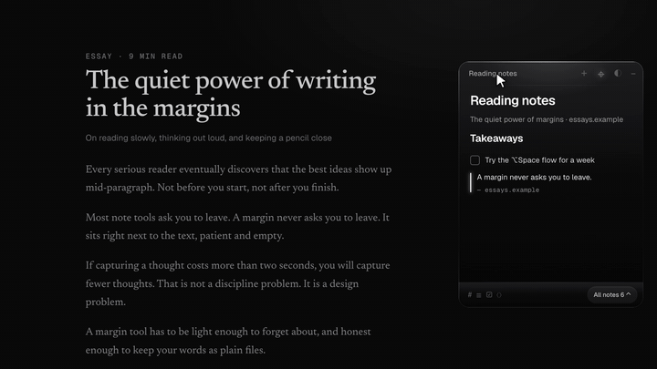

# Margin

A floating, local-first notes panel for macOS. It sits above any app, including full-screen Chrome, so you can write while you read. Notes are plain markdown files on your Mac.

<p align="center">
  <a href="https://margin.motiontic.com/#film"></a>
</p>
<p align="center"><b><a href="https://margin.motiontic.com/#film">▶ Watch the 50-second launch film</a></b> · <a href="docs/media/margin-launch.mp4">download the MP4</a></p>

- **Floats everywhere.** A floating panel that doesn't take focus and appears on every Space, including over full-screen apps.
- **8 spots.** Snap it to any edge or corner. Drag it and the screen shows you where it can land.
- **Minimises to a thin line.** A glowing glass line on its edge, with no text or logo. Click it to open; drag it to move it.
- **Markdown, styled live.** `#` headings, lists, `[ ]` to-dos, quotes, code, dividers, images and link cards. Type `/` for the block menu.
- **Bring things in.** Drop or paste images, videos, files and links. Drag text from a page to get a quote with its source. Take a region screenshot, or clip the front browser tab.
- **All notes drawer.** It slides up from the bottom and pushes your note up instead of covering it, with search and filters.
- **Light.** No web view, nothing running while idle. One dependency: [Sparkle](https://sparkle-project.org), for updates.
- **Updates itself.** New versions download quietly; a card in the panel offers "Restart to update", and the minimised line shows a small glowing dot until you do. Margin asks margin.motiontic.com for a new version once a day and sends nothing about you or your notes. Turn it off with "Check for Updates Automatically" in the menu bar menu.

## Shortcuts

| Keys | Action |
|---|---|
| ⌥ Space | Minimise / expand |
| ⌥ N | New note |
| ⌃⌥ ← ↑ → ↓ | Move the panel between the 8 spots |
| / | Block menu |
| ⌘-click a link | Open it in the browser |

## Download

Get the signed build from **[margin.motiontic.com](https://margin.motiontic.com)**: open the DMG and drag Margin to Applications. Requires macOS 14+ on Apple silicon.

## Build

Requires macOS 14+ and Xcode 16+ (Swift 6 toolchain).

```bash
swift build && .build/debug/Margin     # run a debug build
swift test                             # core tests
scripts/bundle.sh --open               # build dist/Margin.app with its icon and open it
scripts/release.sh                     # Developer ID sign, DMG, notarize + staple
```

`release.sh` notarizes when a notarytool keychain profile named `margin-notary` exists. Create it once with
`xcrun notarytool store-credentials margin-notary --apple-id <apple-id> --team-id <TEAMID>`.

Notes live in `~/Documents/Margin`: one `.md` file per note, media in `assets/`, and a rebuildable search index in `.margin/`.

## Releasing

Updates are signed twice: with the Developer ID certificate (Apple) and with an EdDSA key (Sparkle). The app carries the public half (`SU_PUBLIC_KEY` in `scripts/bundle.sh`) and refuses any update the private half did not sign.

1. Set `VERSION` in `scripts/bundle.sh` and write `releases/<version>.md`: 1 to 5 lines starting with `- `. They appear in the update card.
2. Run `scripts/release.sh`. It builds, signs, notarizes and staples `dist/Margin-<version>.dmg`, then writes `dist/appcast.xml` with the DMG's signature.
3. Publish: copy the DMG to `download/` and `appcast.xml` to the root of the [site repo](https://github.com/csakash/margin-site), update its download links, and deploy it. Installed copies pick the update up within a day.

To stop a bad release, put the previous `appcast.xml` back on the site. Installed copies only ever move to a higher version, so fixing forward means shipping one.

**The signing key.** The private half lives in the maintainer's login keychain (item "Private key for signing Sparkle updates"). Back it up once with `.build/artifacts/sparkle/Sparkle/bin/generate_keys -x <file>` and keep the file in a password manager; restore it on another Mac with `generate_keys -f <file>`. Never commit it.

**Testing an update without publishing.** `scripts/qa-update.sh` builds a 0.2.0 and a 0.2.1 test app under their own bundle id, serves a feed on 127.0.0.1 and launches the old one. `scripts/qa-update.sh --check-only` asserts the bundle and feed are well-formed; `--tamper` corrupts the download, which must be refused.

## Layout

```
Sources/MarginCore   storage, markdown, search (Foundation + SQLite only, unit-tested)
Sources/MarginKit    panel, placement, material, editor, drawer, capture (AppKit + SwiftUI)
Sources/Margin       app entry point and wiring
design/              interactive mockup and the icon source
docs/                implementation plan and build waves
```

See [docs/IMPLEMENTATION_PLAN.md](docs/IMPLEMENTATION_PLAN.md) for the stack decisions and how the build was split into parallel waves.
